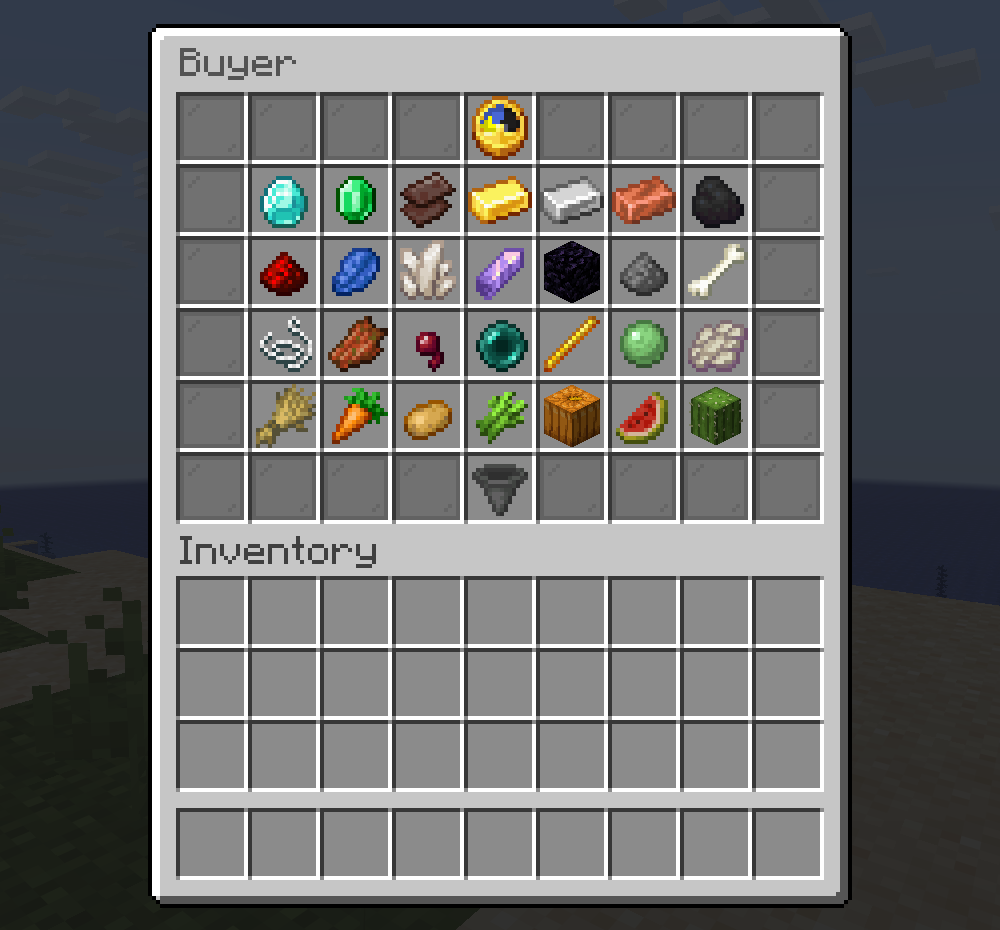
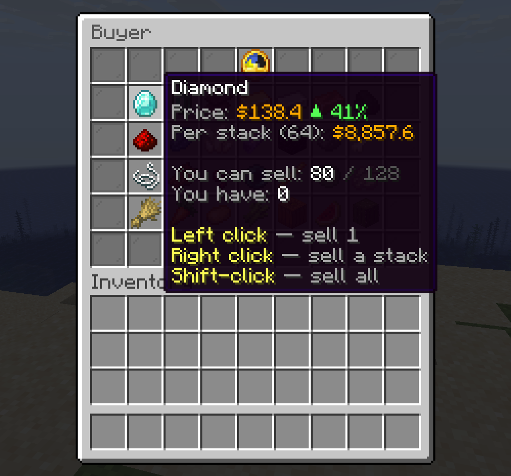

# LootBuyer — скупщик ресурсов для Paper/Purpur 1.21.x

[English version](README.md)

 

Меню, где игроки продают ресурсы серверу. Цены меняются по таймеру, у каждого
предмета свой лимит, донат-группы получают повышенный множитель.

## Возможности

- Меню на 6 рядов: цена, изменение цены (▲/▼ в процентах), остаток лимита, сколько предметов у игрока.
- ЛКМ — продать 1 шт., ПКМ — стак, Shift + клик — всё. Кнопка и команда «Продать всё».
- Смена цен по таймеру: случайная цена в заданном диапазоне. Объявление в чат.
- Режим анархии: при каждой смене цен скупается случайный набор предметов (`items-per-rotation`).
- Лимиты на игрока до следующей смены цен.
- Множители для донат-групп через права `lootbuyer.multiplier.<название>`.
- Защита: скупаются только обычные предметы (без переименования, зачарований, NBT). Броня и вторая рука не продаются. Все клики в меню отменяются: предмет нельзя вытащить или подложить.
- Цены и лимиты сохраняются в `data.yml` и переживают перезапуск.
- Названия предметов в сообщениях показываются на языке клиента игрока.
- Русский и английский язык: `language: ru` или `en` в `config.yml`. Тексты лежат в `lang/<язык>.yml`, формат MiniMessage (градиенты, HEX-цвета). Можно добавить свой язык.
- PlaceholderAPI (необязательно).

## Требования

- Paper или Purpur 1.21.4 и новее, Java 21
- Vault + плагин экономики (EssentialsX, CMI и др.)
- PlaceholderAPI — по желанию

## Команды и права

| Команда | Право | По умолчанию | Что делает |
|---|---|---|---|
| `/buyer` (`/lootbuyer`, `/skupka`, `/skup`) | `lootbuyer.use` | все | Открыть меню |
| `/buyer sellall` | `lootbuyer.sellall` | все | Продать всё подходящее |
| `/buyer reload` | `lootbuyer.admin` | OP | Перезагрузить config.yml и тексты |
| `/buyer rotate` | `lootbuyer.admin` | OP | Сменить цены прямо сейчас |
| `/buyer open <игрок>` | `lootbuyer.admin` | OP | Открыть меню игроку (для NPC и меню) |
| — | `lootbuyer.bypasslimit` | никто | Продавать без лимитов |
| — | `lootbuyer.multiplier.<название>` | никто | Множитель цены из `config.yml` |

## Скупщик-NPC (Citizens)

```
/npc create Скупщик
/npc command add -p buyer
```

Или от имени консоли, без выдачи прав игроку:

```
/npc command add lootbuyer open <p>
```

## Плейсхолдеры

| Плейсхолдер | Значение |
|---|---|
| `%lootbuyer_next%` | Время до смены цен: `12 мин 05 сек` |
| `%lootbuyer_next_seconds%` | То же в секундах |
| `%lootbuyer_price_<id>%` | Текущая цена за 1 шт., например `%lootbuyer_price_diamond%` |
| `%lootbuyer_active_<id>%` | `true`, если предмет сейчас скупается |
| `%lootbuyer_left_<id>%` | Сколько игрок ещё может продать |

## Настройка предметов

```yaml
items:
  diamond: { material: DIAMOND, price: [90, 140], limit: 128 }
  bone:    { material: BONE,    price: 2,         limit: 0 }   # фиксированная цена, без лимита
```

После правок: `/buyer reload`. Если поменять диапазон цены, цена предмета сразу выберется заново.

## Сборка из исходников

```
gradle build
```

Готовый файл: `build/libs/LootBuyer-<версия>.jar`.
